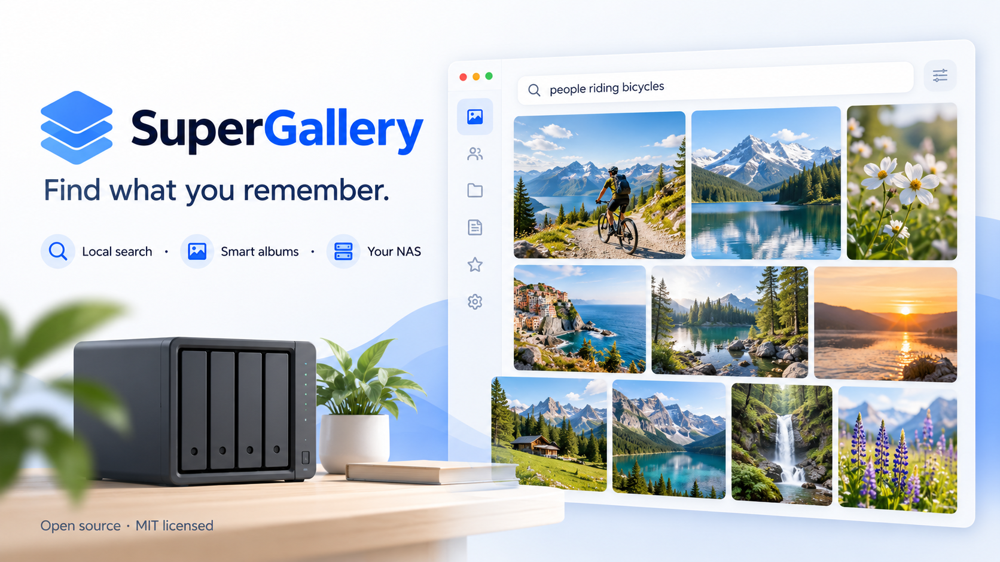

# SuperGallery

**Find what you remember. Keep your library on your NAS.**



*Concept artwork with fictional media; the illustration is not a product screenshot.*

SuperGallery is a self-hosted photo, video and file library with local visual search, face grouping, document search and cleanup tools. Search for “people cycling” or “drinking water”, name groups of familiar faces, and find text inside supported documents without uploading the library to a search service.

[Install](docs/INSTALL.md) · [Download releases](https://github.com/SaiKrishnaDaddala/SuperGallery/releases) · [Upgrade](docs/UPGRADING.md) · [Report a bug](https://github.com/SaiKrishnaDaddala/SuperGallery/issues/new/choose) · [Security](SECURITY.md)

## What it helps with

| Everyday problem | SuperGallery's approach | What to expect |
| --- | --- | --- |
| You remember a scene but not a filename | Local text-to-image search | Ranked suggestions, not guaranteed recognition; indexing is required |
| Photos and documents are scattered across folders | Browse mounted folders through one library | Originals remain in their folders; only explicitly mounted folders are accessible |
| A useful moment is buried in a video | Search sampled frames and open a timestamp | Sampling can miss brief moments; there is no audio transcription |
| A receipt or screenshot is hard to find | Local OCR and document text extraction | Recognition depends on language, image quality and format |
| Similar photos and copies waste space | Review duplicate groups and cleanup suggestions | Review before applying changes; keep an independent backup |
| A large app has tools you never use | Enable or disable nine optional capabilities | Settings are instance-wide; disabled indexes are retained |
| You want access away from home | Explicit external HTTPS address, trusted proxy and required MFA | You supply the gateway; this app does not create a tunnel |

These are workflow benefits, not claims that every commercial gallery lacks these capabilities. You operate the storage, backups, updates and network access yourself.

## Features

- Responsive gallery, folders, timelines, search filters and a keyboard command palette.
- Local photo meaning search with CLIP, video scene search, OCR and document text.
- Local face grouping with manual names. Similarity is imperfect and does not verify identity.
- Smart albums that update as matching files change.
- Resumable indexing jobs with progress, pause/cancel controls and a persistent queue.
- Duplicate and similar-photo review, reversible trash, uploads and optional cleanup rules.
- Password sign-in, authenticator codes, recovery codes and session management.
- App-data backup/restore and feature controls in Settings.

Celebrity lookup is optional, disabled by default and requires a separately configured AWS account. It sends selected face images to Amazon Rekognition when explicitly used. All core search and grouping features work locally. See [privacy](docs/PRIVACY.md).

## Quick start

Use a Linux x86-64 Docker host with Docker Compose v2. Start with a small library and read-only access. First builds download dependencies and approximately 193 MB of pinned model weights; allow additional space for the image, index, thumbnails and backups. CPU indexing may take substantial time on a large library. ARM and GPU configurations are not validated in this release.

```sh
git clone --branch v2.4.0 https://github.com/SaiKrishnaDaddala/SuperGallery.git
cd SuperGallery
cp .env.example .env
# Edit .env: NAS_HOST, LIBRARY_PATH and CONFIG_PATH must match your machine.
docker compose up -d --build
```

Open `https://YOUR_NAS_HOST:8843`, verify the NAS certificate, create your own password, and enable two-step verification in Settings. Scan your selected library, then start the indexes you want. There are no default credentials. The [installation guide](docs/INSTALL.md) includes UGREEN Docker steps, certificate handling and writable-library setup.

## Deployment scope

This release is a Docker-hosted web application. It is not an Apple product and is not affiliated with Apple or UGREEN. It does not automatically appear in the UGREEN mobile app catalog. UGREEN native package distribution requires vendor approval and is not included in this release. Mobile browsers can use the responsive app.

The shared application login grants access to all mounted library content. Folder-owner filters are organizational filters, **not account isolation or NAS ACL enforcement**. Do not expose a multi-user NAS root to people who should see only one folder. Use separate instances and narrowly scoped mounts instead.

## Updates and contributions

Releases use versioned Git tags, source archives and SHA-256 checksums. Updates are explicit: back up, review release notes, check out the desired tag and rebuild. There is no silent self-updater. [Upgrade and rollback instructions](docs/UPGRADING.md).

Use [Issues](https://github.com/SaiKrishnaDaddala/SuperGallery/issues/new/choose) for bugs and feature requests. Never attach personal media, passwords, `.env`, database files, authenticator secrets or unredacted logs. Security reports belong in [private vulnerability reporting](https://github.com/SaiKrishnaDaddala/SuperGallery/security/advisories/new), not public issues.

Contributors can start with [CONTRIBUTING.md](CONTRIBUTING.md), [architecture](docs/ARCHITECTURE.md), [feature controls](docs/FEATURES.md) and [remote access](docs/REMOTE_ACCESS.md).

MIT licensed application source. Third-party models, libraries and system packages retain their own licenses; see [THIRD_PARTY_NOTICES.md](THIRD_PARTY_NOTICES.md).
